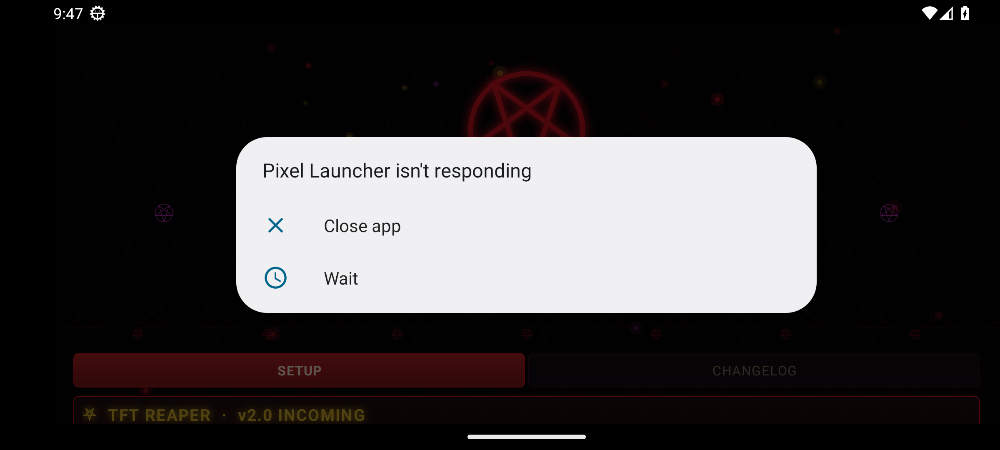
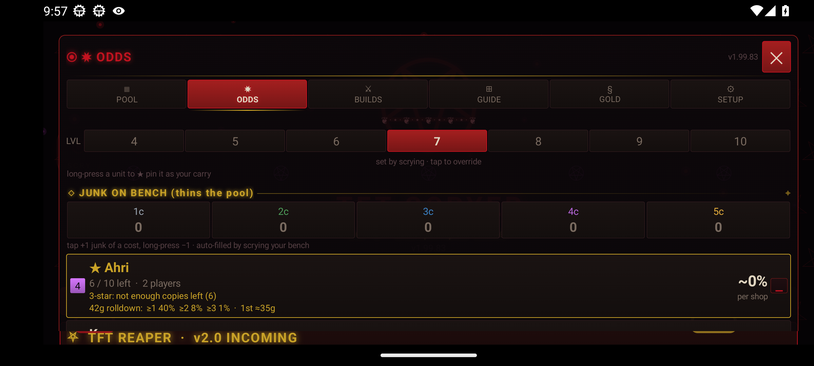
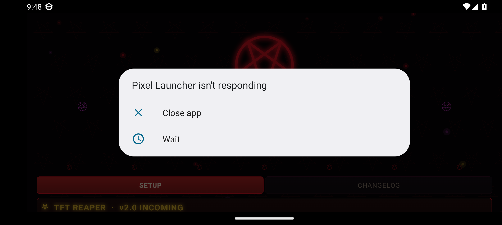
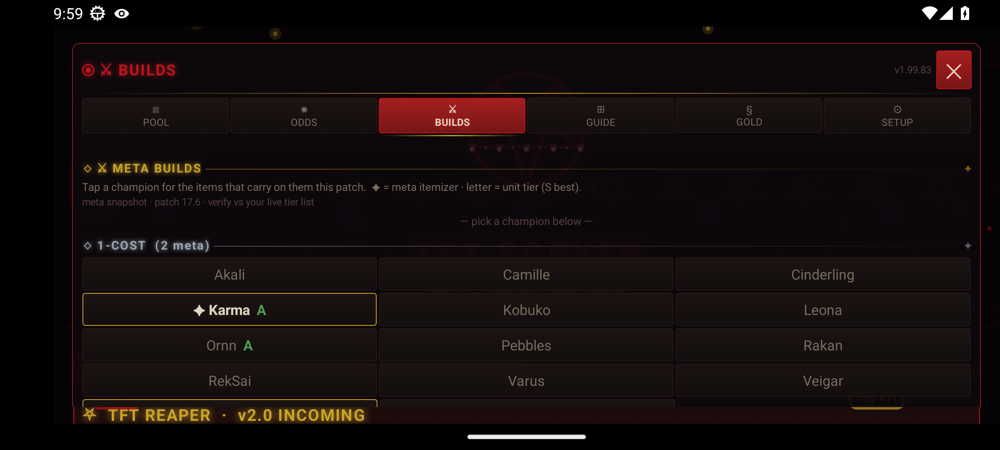
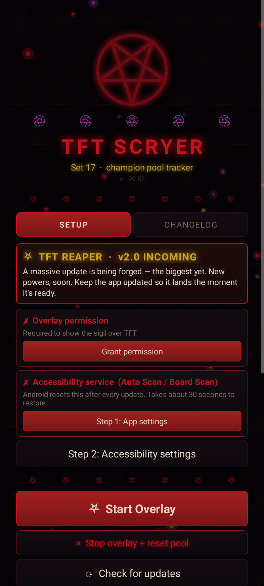

# ⦿ TFT SCRYER

### ✦ Champion pool & reroll-odds overlay for TFT Mobile ✦

*Track the pool, your odds, gold and opponents — without leaving the game.*

 

`❦ · ⋆ · ❦ · ⋆ · ❦ · ⋆ · ❦`

## ✦ What it does

<table>
<tr>
<td width="33%" valign="top" align="center">

### ◇ Pool
See how many copies of every champion are left and who's contesting them.

</td>
<td width="33%" valign="top" align="center">

### ◇ Odds
Your real chance to hit your carry on each roll at your level.

</td>
<td width="33%" valign="top" align="center">

### ◇ Scan
Reads your board, bench, shop, gold and level straight off the screen.

</td>
</tr>
<tr>
<td width="33%" valign="top" align="center">

### ◇ Gold
Interest, streaks and next-round income at a glance.

</td>
<td width="33%" valign="top" align="center">

### ◇ Coach
Comp to commit to, best items, and your next econ or roll move.

</td>
<td width="33%" valign="top" align="center">

### ◇ Guides
Augment tiers, meta builds and item chart for the current set.

</td>
</tr>
</table>

## ✦ Screenshots

<table>
<tr>
<td width="50%"> <b>POOL</b> — copies left, who's contesting, 2★ progress</td>
<td width="50%"> <b>ODDS</b> — your real chance to hit your carry</td>
</tr>
<tr>
<td width="50%"> <b>GOLD</b> — interest, brackets and roll budget</td>
<td width="50%"> <b>BUILDS</b> — items for every champion</td>
</tr>
</table>

## ✦ Install

1. **[Download the APK](https://github.com/Xanfiend/tft-overlay/releases/latest/download/tft-scryer.apk)** on your Android phone.
2. Open it and allow **install from unknown sources** if asked.
3. If Play Protect warns about it, tap **Install anyway** (normal for apps outside the Play Store).
4. Open TFT Scryer → **Start Overlay** → launch TFT. Tap the floating sigil to use it.

> Android only — not for PC or iPhone.

## ✦ Is it safe?

Yes. The full source code is right here. No accounts, no ads, no tracking — everything stays on your phone, and the only network call is checking GitHub for updates. Antivirus warnings on self-signed APKs are a common false positive ([VirusTotal scan](https://www.virustotal.com/gui/file/effaa42fd316d6aa3a2948ee1b0370b176b2a6196d6da846e717dde3ae5f55f0/summary)).

 

`❦ · ⋆ · ❦ · ⋆ · ❦ · ⋆ · ❦`

Version history on the **[Releases](https://github.com/Xanfiend/tft-overlay/releases)** page

Made by **[@ravriks](https://instagram.com/ravriks)**

